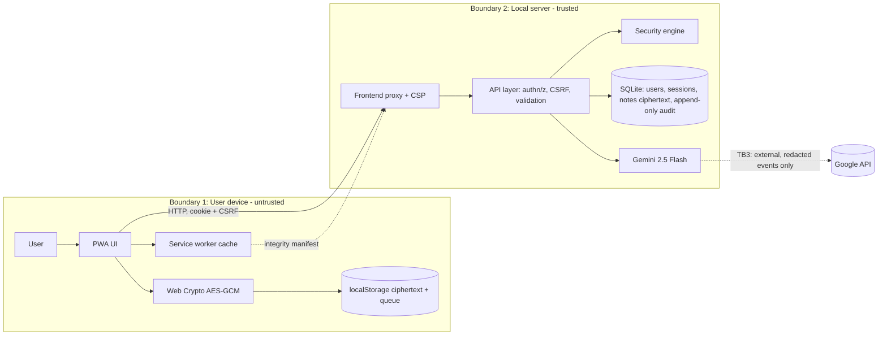

# Threat Model

## Data-flow diagram (trust boundaries)

Boundaries: (1) device/browser, (2) server and database, (3) external AI API.

## Threats and mitigations (STRIDE)
| # | Threat | Mitigation | Evidence |
|---|---|---|---|
| 1 | Credential brute force / stuffing | bcrypt, per (IP, user) lockout, generic error, timing-equalized dummy hash | `test_login_rate_limit` |
| 2 | Stolen session cookie replay | HttpOnly+SameSite=Strict, risk scoring (UA/IP) with auto-revoke, expiry | `test_T2_stolen_session` |
| 3 | CSRF on state change | CSRF token header compared in constant time + SameSite=Strict | `test_csrf_enforced` |
| 4 | Stored/reflected XSS | server rule scan, `textContent` only, strict CSP (`script-src 'self'`) | `test_T4_xss_*` |
| 5 | Cache poisoning / tampered update | SHA-256 manifest verification in SW install, allowlist, `/api` never cached | `test_T3_cache_poisoning` |
| 6 | Server-side data breach reveals notes | notes encrypted client-side (PBKDF2-310k + AES-GCM-256); server stores ciphertext only | `test_T1_...ciphertext_only` |
| 7 | Privilege escalation / IDOR | server-side role checks, ownership checks on notes and sessions, generic 403, audited | `test_authorization_and_generic_denial` |
| 8 | Lost/stolen device | self-service + admin remote revocation of all sessions | `test_T5_device_loss` |
| 9 | Audit log tampering / repudiation | DB triggers block UPDATE/DELETE; SHA-256 hash chain; verify endpoint | `test_audit_append_only_and_tamper_evident` |
| 10 | Replay / duplicate offline submissions | idempotent `op_id`, optimistic version check | `test_T1_...`, `test_Tfinal_...` |
| 11 | DoS via oversized/malformed input | 128 KB body limit, Pydantic field limits, 50 ops/sync, stable 4xx errors | `test_Tfinal_...` |
| 12 | Information leakage via errors/logs | safe error handler, secret redaction in audit, no stack traces | `test_Tfinal_...` |
| 13 | CSV/formula injection in export | leading `= + - @` stripped from text fields | `/api/audit/export` |
| 14 | SQL injection | parameterized queries only | code review (`db.py`, `main.py`) |

Residual risks: see README section 7.
